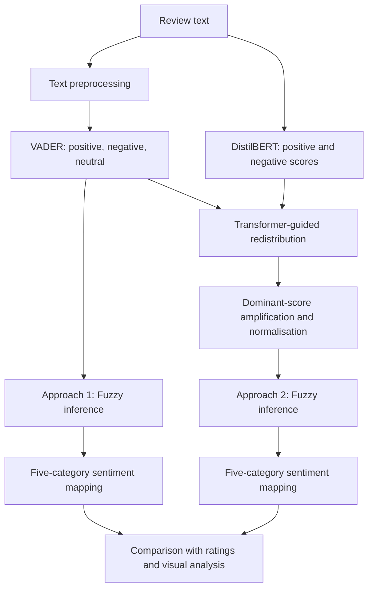

[Uploading README.md…]()
# Enhanced Sentiment Analysis with Lexicon, Transformer, and Fuzzy Logic

**A hybrid, rule-based framework for sentiment analysis across food, hospitality, e-commerce, and clothing reviews**

**Author:** Shayan Rokhva  
**Implementation:** Python / Google Colab / Jupyter Notebook  
**Project status:** Research prototype (not a packaged application)

## Overview

This project explores whether combining a lexicon-based sentiment analyser, a pretrained Transformer, and a fuzzy inference system can produce more informative sentiment scores than relying on lexicon-based evidence alone.

The implementation brings together three complementary components:

1. **VADER**, which estimates the positive, negative, and neutral proportions of a text.
2. **DistilBERT**, a pretrained English-language binary sentiment classifier, which provides positive/negative scores used to guide sentiment refinement.
3. **A fuzzy inference system (FIS)**, which maps the three sentiment proportions to a continuous overall sentiment score using interpretable membership functions and a set of 27 rules.

Two approaches are examined:

- **Approach 1 — Unrefined fuzzy baseline:** VADER sentiment proportions are passed directly to the FIS.
- **Approach 2 — Transformer-guided refinement:** The VADER proportions are adjusted according to DistilBERT sentiment strength, normalised, and then passed to the *same* FIS.

The notebook compares both approaches across four review datasets. It examines sentiment distributions, relationships with customer star ratings, and shifts between baseline and refined sentiment categories.

> **Scope:** This is an experimental sentiment-scoring and analysis workflow. The Transformer is used for inference; the notebook does **not** fine-tune DistilBERT, train the fuzzy rules from data, or establish a validated improvement in classification accuracy.

## Research motivation and objectives

Customer reviews often contain mixed or nuanced opinions, and purely lexicon-based scoring may leave many reviews classified as neutral. This project tests a practical way to inject semantic evidence from a Transformer into an interpretable fuzzy framework without training a new end-to-end model.

The objectives are to:

- Obtain initial positive, negative, and neutral scores from a common lexicon-based analyser.
- Use Transformer-derived positive/negative confidence scores to modify the initial sentiment representation.
- Express overall sentiment on a continuous scale and convert it into five interpretable categories.
- Compare the original and refined approaches across different review domains.
- Investigate whether model scores follow the expected progression from lower to higher review ratings.
- Provide descriptive visualisations and export the processed data for further study.

## Methodology

### Processing flow



**Note:** The original notebook does not apply exactly the same text input to DistilBERT on every dataset. The food, TripAdvisor, and women's clothing branches use their source review text; the Flipkart branch uses the preprocessed review text.

### 1. Data preparation

The notebook imports datasets with `pandas`, inspects review/rating distributions, and creates a `preprocessed comment` column. Its `clean()` function performs:

- Lowercasing.
- Removal of bracketed text, URLs, HTML-like tags, punctuation, line breaks, and tokens containing digits.
- English stop-word removal using NLTK.
- English Porter stemming.

For the food dataset, the sentiment analysis uses an English-translation column alongside the original Persian comments. The implemented VADER and DistilBERT pipelines are English-language approaches; the notebook does **not** directly perform Persian-language sentiment modelling.

**Important methodological consideration:** VADER is generally intended to interpret natural, unstemmed text, including punctuation, emphasis, and negation. Removing these features before scoring may reduce its effectiveness. This notebook applies VADER to the cleaned text; using original text would be a worthwhile controlled comparison.

### 2. Lexicon-based sentiment scores: VADER

For each cleaned review, VADER produces:

- `Positive_VADER`: positive proportion.
- `Negative_VADER`: negative proportion.
- `Neutral_VADER`: neutral proportion.

These values form the three inputs to the fuzzy inference system. The notebook uses the `pos`, `neg`, and `neu` VADER outputs; it does not use VADER's `compound` score in the fuzzy models.

### 3. Fuzzy inference system

The notebook defines a fuzzy inference system using **scikit-fuzzy**. Each of the three input variables—positive, negative, and neutral—ranges from 0 to 1 and has three linguistic memberships:

| Membership | Function | Parameters |
|---|---|---|
| Low | Trapezoidal | `[0, 0, 0.3, 0.5]` |
| Medium | Triangular | `[0.3, 0.5, 0.7]` |
| High | Trapezoidal | `[0.5, 0.7, 1, 1]` |

The output variable, `overall_sentiment`, also ranges from 0 to 1 and uses three memberships:

| Output | Function | Parameters |
|---|---|---|
| Negative | Trapezoidal | `[0, 0, 0.3, 0.5]` |
| Neutral | Triangular | `[0.3, 0.5, 0.7]` |
| Positive | Trapezoidal | `[0.5, 0.7, 1, 1]` |

**Rule base:** All **27 combinations** of the three input memberships (3 × 3 × 3) are explicitly defined. For example:

- Low positive + high negative + low neutral → negative overall sentiment.
- High positive + low negative + low neutral → positive overall sentiment.
- Medium positive + medium negative + medium neutral → neutral overall sentiment.
- High positive + high negative + high neutral → neutral overall sentiment.

The same rules and membership functions are used for both approaches and across the active datasets. They are **manually specified** in the notebook rather than learned or optimised from labelled data.

### 4. Approach 1: VADER + fuzzy inference (baseline)

The original VADER positive, negative, and neutral scores are assigned to the three FIS inputs. The FIS calculates a continuous output for each review:

```python
sentiment_sim.input['positive'] = row['Positive_VADER']
sentiment_sim.input['negative'] = row['Negative_VADER']
sentiment_sim.input['neutral'] = row['Neutral_VADER']
sentiment_sim.compute()
score = sentiment_sim.output['overall_sentiment']
```

The result is stored in `Overall_Sentiment_NO_refinement`.

### 5. DistilBERT sentiment evidence

The notebook runs the pretrained Hugging Face model:

```text
distilbert-base-uncased-finetuned-sst-2-english
```

The binary classifier returns a predicted `POSITIVE` or `NEGATIVE` label with an associated score. The code converts this result to two complementary values:

- `Transformer_positive_score`
- `Transformer_Negative_score`

For instance, a `POSITIVE` output with score `0.97` is represented as positive `0.97` and negative `0.03`.

The TripAdvisor, women's clothing, and Flipkart branches tokenize the input and truncate it to a maximum of 512 tokens before inference. The food branch calls the sentiment pipeline directly without an explicit truncation step. The model is **pretrained and used for inference only**; no model training or fine-tuning occurs in the notebook.

### 6. Approach 2: Transformer-guided refinement + fuzzy inference

This is the central hybrid component. It takes VADER's three scores, redistributes a fraction of the neutral component according to the Transformer, optionally amplifies the dominant component, then re-runs the original fuzzy system.

**Phase A — Initialise from VADER.** The three VADER scores are copied into:

```text
Refined_Positive
Refined_Negative
Refined_Neutral
```

**Phase B — Redistribute neutral sentiment.** Depending on Transformer evidence, a fraction of the current neutral score is transferred to the Transformer-supported positive or negative component:

| Transformer score range | Fraction of neutral score transferred |
|---|---:|
| `0.70 ≤ score < 0.80` | 10% |
| `0.80 ≤ score < 0.90` | 20% |
| `score ≥ 0.90` | 30% |

The transfer direction follows the stronger qualifying **positive or negative** Transformer score. The code checks positive thresholds first and then negative thresholds, stopping at the first applicable condition. This is a heuristic, fixed-threshold adjustment, not a learned fusion weight.

**Phase C — Amplify strong sentiment.** If `Transformer_positive_score > 0.95`, the refined positive value is replaced by its square root. Otherwise, if `Transformer_Negative_score > 0.95`, the negative value is replaced by its square root. For a value between 0 and 1, square-rooting increases its magnitude unless it is at an endpoint.

**Phase D — Normalise.** The three adjusted values are divided by their sum, making the resulting sentiment proportions sum to 1 when the sum is nonzero. The implementation provides an all-zero fallback if the sum is zero.

**Phase E — Re-run the FIS.** The refined positive, negative, and neutral values are submitted to the same 27-rule fuzzy model. Its output is stored as `Overall_Sentiment_ReFined`.

### 7. Five sentiment categories

Both continuous fuzzy scores are converted to labels using exactly the thresholds implemented in the notebook:

| Overall sentiment score | Category |
|---|---|
| `0 ≤ score ≤ 0.30` | Negativity |
| `0.30 < score < 0.40` | Slight Negativity |
| `0.40 ≤ score ≤ 0.60` | Neutrality |
| `0.60 < score < 0.70` | Slight Positivity |
| `0.70 ≤ score ≤ 1.00` | Positivity |
| Outside the ranges above | Unknown |

These thresholds produce the columns `Overall_Sentiment_NO_refinement_Category` and `Overall_Sentiment_Refined_Category`.

## Datasets

The notebook includes four **active** datasets and a fifth, commented-out TikTok data branch.

| Dataset | Source file expected by the notebook | Review text used | Rating column | Rows initially loaded in saved outputs |
|---|---|---|---|---:|
| Iranian food comments | `FinalFoodCommentDataset_PersianCommentFood_Shayan_.xlsx` | `comment` (renamed English-translation column) | `Scores` (renamed from `Stars (Rank)`) | 1,266 |
| TripAdvisor hotel reviews | `tripadvisor_hotel_reviews_Kaggle.csv` | `Review` | `Rating` | 20,491 |
| Flipkart customer reviews | `Flipkart_Customer_Review_and_Rating.csv` | `review` | `rating` | 9,976 |
| Women's clothing e-commerce reviews | `Womens_Clothing _ECommerce_Reviews.csv` | `Review Text` | `Rating` | 23,486 |

The **TikTok/Google Play** CSV (`TIKTOK_GooglePaly_Reviews_Shayan_.csv`) is referenced, but its loading and analysis cells are commented out, so it is **not part of the active results**.

**Sampling and notebook-state caveat:** Active code takes the first 1,000 rows of the TripAdvisor, Flipkart, and women's clothing datasets, while the food dataset's limiting code is commented out. However, several saved outputs later in the notebook reflect **full-data analyses** for these datasets, and an earlier food output also shows 1,000 rows. This indicates cells were executed in different orders or states. Consequently, the saved notebook does not represent a single verified, clean, top-to-bottom run. For reproducible comparisons, first choose a fixed sample policy and rerun all cells in order.

**Data availability:** The actual dataset files are not embedded in the uploaded notebook. Dataset distribution rights, licences, and download links must be established separately before publishing the data.

## Results and analysis

The notebook contains descriptive comparisons of the baseline and refined outputs, including:

- Counts of reviews in each sentiment class.
- Mean and median star ratings within each predicted sentiment class.
- Minimum, quartiles, median, mean, and maximum fuzzy sentiment scores grouped by star rating.
- Boxplots and sentiment-distribution visualisations by rating.
- Confusion-matrix-style heatmaps comparing **unrefined predictions against refined predictions**.
- Descriptive checks of how frequently DistilBERT produces high scores.

### Examples from the notebook's saved outputs

The table below reports **mean continuous sentiment scores** by customer rating, taken from saved notebook outputs. They are observations from the saved execution state, **not results of a new independent run**.

| Dataset | Rating | Baseline mean | Refined mean |
|---|---:|---:|---:|
| Food | 2 | 0.498 | 0.306 |
| Food | 5 | 0.679 | 0.741 |
| TripAdvisor | 1 | 0.500 | 0.282 |
| TripAdvisor | 5 | 0.566 | 0.733 |
| Women's clothing | 1 | 0.529 | 0.391 |
| Women's clothing | 5 | 0.614 | 0.752 |
| Flipkart | 1 | 0.470 | 0.349 |
| Flipkart | 5 | 0.644 | 0.674 |

These examples show that, in the saved outputs, refinement often produces **greater separation in average fuzzy scores** between lower- and higher-rated reviews. That is a promising descriptive observation, but **it is not evidence of higher classification accuracy**.

The confusion matrices in the notebook compare **Approach 1 versus Approach 2**, not predictions versus manually verified ground-truth sentiment labels. They show **how predictions change**, not whether the changes are correct. Review star ratings provide useful contextual evidence but are not necessarily exact sentiment annotations.

### Visualisations and exported outputs

The notebook saves the following processed tables to the current working directory:

```text
df_food.csv
df_trip_advisor.csv
df_FlipKart.csv
df_women_clothing.csv
```

It also contains code to save several JPEG visualisations, including:

```text
Fig_Rating_Distribution_Datasets.jpeg
Sentiment_Boxplots_Food.jpg
Sentiment_Boxplots_TripAdvisor.jpg
Sentiment_Boxplots_Womens_Clothing.jpg
Sentiment_Boxplots_FlipKart.jpg
Confusion_Matrix_Food.jpeg
Confusion_Matrix_Trip_Advsior.jpeg
Confusion_Matrix_Women_Clothing.jpeg
Confusion_Matrix_FlipKart.jpeg
```

Additional detailed distribution figures are saved using longer filenames within the notebook. Output files are only produced when the corresponding cells execute successfully.

## Technology stack

- **Language and environment:** Python, Jupyter Notebook, Google Colab.
- **Data manipulation:** pandas, NumPy.
- **Text processing:** NLTK, Python regular expressions.
- **Lexicon sentiment:** NLTK VADER.
- **Transformer inference:** Hugging Face `transformers`, pretrained DistilBERT, PyTorch backend.
- **Fuzzy inference:** `scikit-fuzzy` (`skfuzzy.control`).
- **Visualisation:** Matplotlib, Seaborn; `wordcloud` is imported in the initial setup.
- **Analysis utilities:** scikit-learn's `confusion_matrix`.
- **Data formats:** XLSX and CSV inputs; CSV and JPEG outputs.

## Getting started

### 1. Open the notebook

The existing project is implemented as a single `.ipynb` file, designed around **Google Colab** and a mounted Google Drive. Open it in Colab, or adapt file paths and the `drive.mount()` cell to run locally in Jupyter.

### 2. Install dependencies

In Colab or a Python notebook:

```python
%pip install pandas numpy matplotlib seaborn nltk wordcloud \
    scikit-fuzzy transformers torch scikit-learn openpyxl
```

The notebook itself explicitly installs `scikit-fuzzy`; other packages may already be available in Colab. The command above collects the principal imported dependencies into one place. Package versions were not pinned in the original notebook.

### 3. Download the NLTK resources

```python
import nltk
nltk.download('stopwords')
nltk.download('vader_lexicon')
```

### 4. Make the datasets accessible

The active loading cells use the following Google Drive paths:

```text
/content/drive/MyDrive/FinalFoodCommentDataset_PersianCommentFood_Shayan_.xlsx
/content/drive/MyDrive/tripadvisor_hotel_reviews_Kaggle.csv
/content/drive/MyDrive/Flipkart_Customer_Review_and_Rating.csv
/content/drive/MyDrive/Womens_Clothing _ECommerce_Reviews.csv
```

These are the **exact filenames referenced in the code**, including the space in the women's clothing filename. Supply the actual data files yourself and update these paths as needed.

In Google Colab, the notebook mounts Drive using:

```python
from google.colab import drive
drive.mount('/content/drive')
```

### 5. Choose the dataset size deliberately

The notebook contains active `.iloc[:1000]` sampling on three datasets. Decide whether to work with the full datasets or consistent smaller subsets, and either retain or remove those lines. If comparing methods, run both approaches on the **same rows**.

### 6. Execute the notebook in order

Run the cells from top to bottom:

1. Imports and Drive mounting.
2. Data loading, inspection, and preprocessing.
3. VADER scoring and FIS construction.
4. Unrefined fuzzy scoring.
5. DistilBERT inference.
6. Sentiment redistribution, amplification, and normalisation.
7. Refined fuzzy scoring and categorical mapping.
8. Comparative analyses, figures, and CSV exports.

**Do not rely on saved cell outputs alone.** They include observations from inconsistent execution states. The DistilBERT model may need to be downloaded on first use, and row-by-row CPU inference can be time-consuming on the full datasets.

## Output columns

The generated DataFrames include the following project-specific fields in addition to original dataset columns:

| Column | Description |
|---|---|
| `preprocessed comment` | Cleaned review text |
| `Positive_VADER`, `Negative_VADER`, `Neutral_VADER` | Lexicon-based input proportions |
| `Transformer_positive_score`, `Transformer_Negative_score` | Complementary Transformer-derived positive/negative scores |
| `Overall_Sentiment_NO_refinement` | Fuzzy output before Transformer-guided adjustment |
| `Refined_Positive`, `Refined_Negative`, `Refined_Neutral` | Redistributed and normalised sentiment components |
| `Overall_Sentiment_ReFined` | Fuzzy output after adjustment |
| `Overall_Sentiment_NO_refinement_Category` | Baseline five-level category |
| `Overall_Sentiment_Refined_Category` | Refined five-level category |

The column names, including their mixed capitalisation and spelling, are preserved here exactly as used in the notebook.

## Limitations and reproducibility considerations

This notebook is a useful experimental prototype, but several issues should be addressed before drawing publication-level conclusions:

1. **No independent labelled sentiment evaluation.** The notebook does not report held-out sentiment accuracy, macro-F1, precision, recall, or confidence intervals against verified sentiment annotations. Comparisons with star ratings and baseline-versus-refined confusion matrices cannot substitute for these metrics.
2. **Potential preprocessing mismatch.** English stop-word removal and stemming may erase negation and emphasis that VADER needs. The Transformer also receives original review text for some datasets but processed text for Flipkart.
3. **Heuristic fusion.** The 0.70/0.80/0.90 redistribution thresholds, 10%/20%/30% shifts, square-root amplification at >0.95, and fuzzy rule definitions are manually set; their optimality has not been demonstrated in the notebook.
4. **Transformer confidence is not calibrated probability.** A high score should not automatically be interpreted as well-calibrated confidence, especially across different domains.
5. **English-language scope.** Food comments originate in Persian, but their English translations are used. Translation quality may change sentiment cues.
6. **Dataset size and notebook execution state differ.** Several cached outputs describe full datasets despite active 1,000-row sampling cells. Re-run in a fresh kernel and record actual sample sizes.
7. **Row-by-row inference and repeated code.** The current design applies the Transformer individually to reviews and duplicates similar processing blocks across datasets. Batched inference and reusable functions would improve efficiency and maintainability.
8. **No versioned environment or data package.** The original notebook does not contain pinned dependencies or the referenced input datasets, so an exact rerun is not guaranteed without further setup.
9. **No trained fusion model.** The integration is an interpretable, hand-defined refinement procedure, not a jointly trained multimodal or ensemble network.
10. **Domain generalisability remains to be validated.** Performance claims require consistent baselines, suitable held-out labels, domain-wise evaluation, and statistical uncertainty estimates.

## Recommended next steps

For a more rigorous research implementation:

- Organise preprocessing, VADER, Transformer inference, adjustment logic, fuzzy inference, and reporting into reusable modules.
- Compare original versus preprocessed input for VADER and use a consistent Transformer text-preparation policy.
- Add a clean, stratified, reproducible evaluation split and independent sentiment labels.
- Evaluate VADER alone, DistilBERT alone, VADER+FIS, and Transformer-guided VADER+FIS using comparable metrics.
- Report macro-F1, class-level precision/recall, confusion matrices against **true labels**, and uncertainty intervals; examine class imbalance.
- Run ablations of redistribution thresholds, square-root amplification, and fuzzy rules.
- Test out-of-domain generalisation and translated-versus-original-language effects.
- Batch Transformer inference and record package versions, seeds where applicable, data provenance, and execution environment.

## Project structure

Only the notebook was supplied for this documentation. The directory below is a **suggested** repository layout, not a claim that these files already exist:

```text
sentiment-analysis-lexicon-transformer-fuzzy/
├── README.md
├── sentiment_analysis.ipynb       # Rename the supplied notebook if desired
├── data/                          # Not included; add only if redistribution is permitted
├── outputs/                       # Generated CSV tables and figures
├── requirements.txt               # Optional: add tested, pinned versions
└── LICENSE                        # Optional: specify repository licensing terms
```

## Attribution and licence

**Project author:** Shayan Rokhva. The notebook includes the original experimental code and results for the sentiment-analysis workflow documented above.

Third-party datasets, pretrained model weights, and Python libraries remain subject to their own distribution and usage terms. **No project licence was specified in the supplied notebook**; add a `LICENSE` file only after choosing the intended terms.

---

**Summary:** This project investigates a transparent, two-stage hybrid sentiment workflow in which Transformer-derived evidence adjusts VADER sentiment proportions before fuzzy inference. Saved exploratory analyses suggest that the refined scores can distinguish lower- and higher-rated reviews more clearly in several domains. Rigorous, labelled evaluation is still required to determine whether the method actually improves sentiment classification.
